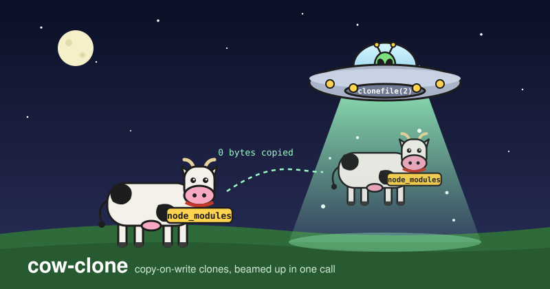

# cow-clone



Copy-on-write clones of files and whole directory trees, from Node or the
command line, on macOS, Linux and Windows. A clone shares every block with
its source until one of them changes, so cloning a 4 GB `node_modules` takes
no space and a fraction of a copy's time. When a clone is not possible,
`cow-clone` says why, so you can copy instead.

```js
import { cloneMany } from "cow-clone";

const results = await cloneMany([
  ["node_modules", "../feature/node_modules"],
  ["ios/Pods", "../feature/ios/Pods"],
]);
for (const result of results)
  if (!result.cloned)
    console.log(result.destination, result.reason, result.code);
```

| Platform | File systems that clone                                   | How                                                          |
| -------- | --------------------------------------------------------- | ------------------------------------------------------------ |
| macOS    | APFS                                                      | One `clonefile(2)` call per pair, a whole tree at a time     |
| Linux    | btrfs, XFS formatted with reflink (the default), bcachefs | `ioctl(FICLONE)` per file, walking the tree                  |
| Windows  | ReFS, Dev Drive                                           | `FSCTL_DUPLICATE_EXTENTS_TO_FILE` per file, walking the tree |

The package ships prebuilt binaries for x64 and arm64 on each platform. It has
no install scripts, no runtime dependencies, and needs no compiler.

## Why not `fs.cp` or `fs.copyFile`

Node's `fs.copyFile(src, dest, fs.constants.COPYFILE_FICLONE)` asks libuv for
a clone. On Linux libuv tries `ioctl(FICLONE)` and silently falls back to a
copy. On macOS it does not clone at all: `COPYFILE_FICLONE_FORCE` fails with
`ENOSYS`, and `COPYFILE_FICLONE` makes a full copy, because libuv reverted
its `clonefile` support ([libuv#3987](https://github.com/libuv/libuv/pull/3987);
[libuv#5295](https://github.com/libuv/libuv/pull/5295) is open). On Windows
`COPYFILE_FICLONE_FORCE` fails with `ENOSYS` and `COPYFILE_FICLONE` calls
`CopyFileW`, which block-clones on ReFS and Dev Drive only on recent
Windows 11 and Windows Server 2025 builds
([Microsoft](https://learn.microsoft.com/en-us/windows/win32/fileio/block-cloning)),
and copies otherwise without saying so. `fs.cp` does the
same per file, so it never clones a tree in one call and never tells you
whether it cloned.

On Linux, `copy_file_range(2)` shares extents on btrfs and XFS when it can,
but also falls back to an in-kernel copy without saying so; it suits a
fallback copy, not a clone that must be one.

`cow-clone` clones or fails, and tells you which:

- A directory on APFS is one `clonefile(2)` call, which is several times faster
  than cloning its files one by one (see [Benchmarks](#benchmarks)).
- Many pairs run in one child process, passed on stdin, so there is one
  process start for the lot and no command-line length limit.
- A pair that cannot be cloned fails at its first file, says why
  (`unsupported`, `cross-device` or another errno), and removes what it had
  created, so a fallback copy starts from a clean destination.

## Install

```bash
npm install cow-clone
```

## Library

```js
import { clone, cloneMany, binaryPath, CowCloneError } from "cow-clone";

const result = await clone("node_modules", "/tmp/copy/node_modules");
if (!result.cloned && result.reason !== "failed") {
  // unsupported or cross-device: a copy is the only option
  await fs.promises.cp("node_modules", "/tmp/copy/node_modules", {
    recursive: true,
    verbatimSymlinks: true,
  });
}
```

`cloneMany(pairs, { signal, timeoutMs })` clones each `[source, destination]`
pair in order in one child process and resolves with one result per pair, in
the same order. `clone(source, destination, options)` is the same for one
pair. A pair that fails does not stop the others.

Each result has `source`, `destination` and `cloned`. When `cloned` is
`false` it also has:

- `reason`:
  - `unsupported`: the file system cannot clone: ext4, tmpfs, NTFS, HFS+,
    FAT, exFAT, most network shares.
  - `cross-device`: the source and the destination are on different volumes.
  - `failed`: anything else, for example a missing source (`ENOENT`), an
    existing destination (`EEXIST`), a permission error (`EACCES`) or a full
    disk (`ENOSPC`).
- `code`: the errno name. Windows errors are mapped to the same names
  (`ENOENT`, `EACCES`, `EEXIST`, `EXDEV`, `ENOTSUP`, ...), or `WIN32_<number>`.
  `ESPECIAL` is a FIFO, socket or device file in a tree on Linux.
- `message`: the system's message for the error.
- `path`: the path the failing call was about, which can be an entry deep in
  the source or the destination.

The destination must not exist; its parent must. A failed pair leaves the
destination as it was: when a tree fails part-way, what was created is
removed.

The promise rejects only when the binary cannot do its job, with a
`CowCloneError` whose `code` is `no-binary` (no prebuilt binary for this
platform), `timeout` (`timeoutMs` ran out) or `failed` (the binary could not
start or printed no result). An aborted `signal` rejects with its reason. A
timeout or an abort kills the child, which can leave a partial destination.

The library does not copy on its own when a clone fails. Whether a copy is
acceptable (it takes real space and time), how to copy (keep modes and times
or not, follow links or not) and what to do on `failed` differ between
callers, and `fs.cp` already copies.

`binaryPath()` returns the absolute path of the prebuilt binary, or `null`.

TypeScript types are included. Node `^20.19.4 || >=22.12.0`.

## Command line

```text
cow-clone [--json] [--] <source> <destination> [<source> <destination>]...
cow-clone [--json] --stdin
```

`--stdin` reads the pairs from stdin, each path ending in a NUL byte. Without
`--json`, success prints nothing and each failure prints one line on stderr:

```console
$ cow-clone node_modules /Volumes/USB/node_modules
cow-clone: /Volumes/USB/node_modules: Cross-device link (EXDEV)
```

`--json` prints `{"results":[...]}` with the fields above, without `source`
and `destination`.

| Exit status | Meaning                                          |
| ----------- | ------------------------------------------------ |
| 0           | Every pair cloned.                               |
| 1           | At least one pair did not; the others still ran. |
| 2           | A usage error. Nothing was cloned.               |

On Windows in cmd.exe and PowerShell the command is `cow-clone-windows`, for
the reasons [real-size](https://github.com/appandflow/real-size#install)
gives: the `cow-clone` command is a `#!/bin/sh` launcher, and
`cow-clone-windows` is the x64 binary itself, which starts the arm64 binary on
Windows on Arm.

## What a clone keeps

| Kept                               | macOS                     | Linux                       | Windows                            |
| ---------------------------------- | ------------------------- | --------------------------- | ---------------------------------- |
| File data, shared with the source  | yes                       | yes                         | yes                                |
| Symbolic links, never followed     | yes                       | yes                         | symbolic links and junctions       |
| File modes                         | yes                       | yes, with setuid and setgid | read-only, hidden, system, archive |
| File modification and access times | yes                       | yes                         | yes, and creation time             |
| Directory modification times       | no: the time of the clone | yes                         | yes                                |
| Extended attributes, ACLs          | yes                       | no                          | no                                 |
| Owner and group                    | the caller's              | the caller's                | the caller's                       |
| Hard links inside the tree         | become separate files     | become separate files       | become separate files              |

- On Linux a FIFO, socket or device file in a tree fails the pair with
  `ESPECIAL`.
- On Windows, setting a symbolic link needs the create-symbolic-link
  privilege (an elevated process or Developer Mode); without it a tree with a
  symbolic link fails with `EPERM`. Junctions need no privilege. Other reparse
  points, such as OneDrive placeholders, are read through.
- The source should not change during a clone. A file written while it is
  cloned can be cloned in either state.

## Benchmarks

`npm run bench -- --source <dir> --scratch <dir on the same volume>` clones a
tree in several ways. On an M4 Pro (APFS), a React Native app's
`node_modules`: 1,104 top-level entries, 51,490 files, 655 MB. Median of 3
runs:

| Variant                                                    |     ms |
| ---------------------------------------------------------- | -----: |
| every top-level entry as a pair, one `cloneMany` call      |  1,427 |
| every top-level entry, one process per entry               |  4,479 |
| the whole tree as one pair                                 |  1,293 |
| file by file (the Linux walker, built for macOS)           | 10,669 |
| `cp -Rc`                                                   |  9,565 |
| `fs.cpSync` with `COPYFILE_FICLONE` (a real copy on macOS) | 16,396 |

The CI `bench` job runs the same script on a generated `node_modules` on
APFS, btrfs, XFS and ReFS.

## Agent skill

The package includes a skill at [`skill/SKILL.md`](skill/SKILL.md) that tells
coding agents to clone rather than copy large folders. Install it with
`npx skills add appandflow/cow-clone`, or copy the `skill` folder into your
agent's skills directory under the name `cow-clone`.

## Development

Building needs a C11 compiler: `cc` on macOS and Linux (a static glibc for the
Linux build), MSVC `cl` on Windows. On macOS `npm run build` also builds
`build/cow-clone-walk`, the Linux tree walker on top of `fclonefileat(2)`,
so the tests run the walker on APFS.

```sh
npm ci --ignore-scripts
npm run build
npm run typecheck
npm run format:check
npm test
```

On Linux the tree tests need btrfs or XFS directories in
`COW_CLONE_REFLINK_DIRS` (separated by `:`), and on Windows a ReFS directory
in `COW_CLONE_REFS_DIR`; under `CI` they fail without them. CI makes loopback
btrfs and XFS mounts and a ReFS virtual disk. See [RELEASING.md](RELEASING.md).

## License

MIT
